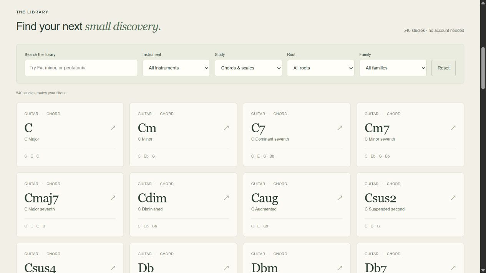

# One Note

**直接体验：[打开 One Note](https://ymping666.github.io/project2/)**

540 个英文音乐学习页面：标准调弦吉他、高 G 尤克里里和钢琴各 180 页。每种乐器覆盖 12 个根音下的 9 类和弦和 6 类音阶，共 108 个和弦页、72 个音阶页。

和弦包括大、小、属七、小七、大七、减、增、sus2、sus4；音阶包括大调、自然小调、和声小调、上行旋律小调、大调五声音阶和小调五声音阶。原有 120 页链接继续有效。

- 图谱、音名、级数和实际低音。
- 双音位、A/B 对比播放、A4 = 440 Hz 参考音。
- 搜索、筛选、按音符反查，以及四题练习和浏览器进度保存。
- 无登录、付费 API、数据库、第三方音源或 npm 依赖。



## 本地开发

需要 Node.js 22 或更高版本。在仓库根目录运行：

```sh
node build.mjs
node verify.mjs
node server.mjs
```

打开 <http://127.0.0.1:4176/>。Windows 也可以先构建后双击 `start-site.cmd`。

## GitHub Pages

GitHub Pages 已启用，从 `main` 分支的 `/docs` 免费发布。

```sh
node scripts/build-pages.mjs
node scripts/verify-pages.mjs
```

提交 `docs` 后 GitHub Pages 会更新。构建脚本适配 `/project2/`，同时处理 HTML 链接与嵌入数据中的动态导航路径。默认仍为 `noindex` 预览；没有接广告，也不代表已经获得搜索流量或收入。

`src/` 是网站源码，`tests/` 是音乐数据、图谱和音频生命周期测试，`qa/` 包含可在本地服务器打开的开发者检查页。音频来自浏览器原生振荡器；数字音高验证不代表真实乐器音色或扬声器声学校准。生成音位尚未经过真人指法验证。

旧的本地工作目录和历史验收材料不随此仓库发布。
